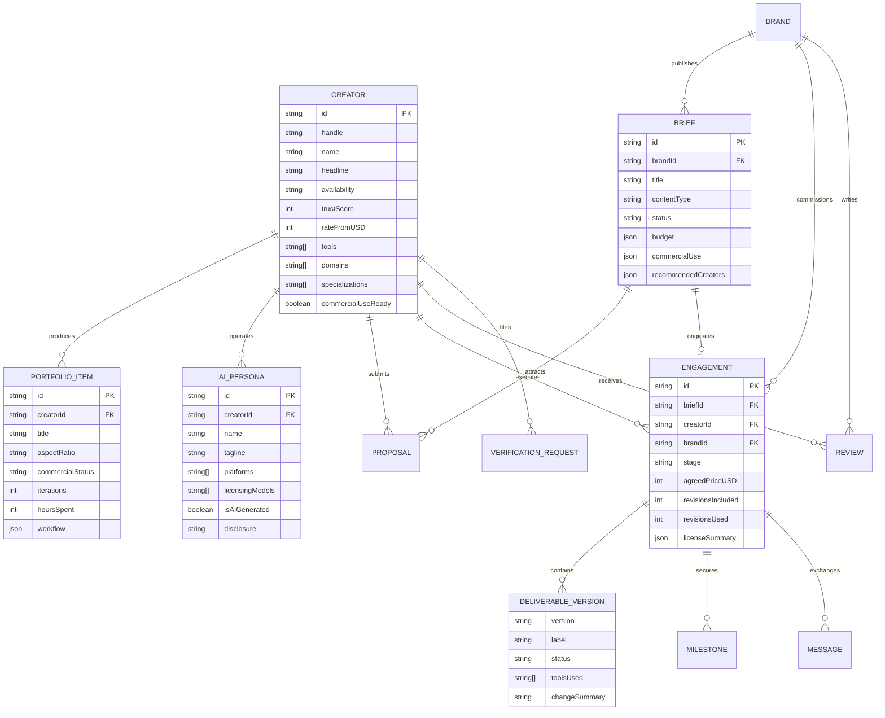

# Kroma Data Model Specification & Architecture

## Overview

The Kroma data architecture addresses the fundamental disconnect between conventional creative contracts and **generative AI pipelines**. In traditional work, a file is an atomic output of human labor. In AI work, an output is the composite result of multi-model conditioning (e.g. Midjourney for styleframes, Kling or Google Veo for motion generation, ElevenLabs for voice clone dubbing, DaVinci Resolve for color matching).

This document details why each field is modeled the way it is.

---

## 1. Key Entities & Domain Design

### 1.1 The Creator Entity (`Creator`)
- **`tools: string[]`**: Maps to verified tools in `tools.json`. Enables brands to filter for creators skilled in specific toolsets (e.g. `blender` + `runway` for CAD product accuracy, or `comfyui` + `flux` for character face-locking).
- **`verification: VerificationInfo`**: Contains tripartite signals:
  1. `tools`: Verification that creator has paid commercial licenses for their generative tools.
  2. `workflow`: Screen recording verifying authentic prompt-to-export execution.
  3. `pastWork`: Verifiable live client campaign reference.
- **`trustScore: number` (0–100)**: Formatted as a deterministic weighted composite:
  - Tools verification: `30 pts`
  - Workflow verification: `30 pts`
  - Past work verification: `25 pts`
  - Profile completeness: `15 pts`
- **`commercialUseReady: boolean`**: Flag indicating the creator self-declares that all tool outputs and voice inputs meet enterprise commercial indemnity standards.

### 1.2 The Portfolio Entity (`PortfolioItem`)
- **`workflow: WorkflowStep[]`**: An ordered array of `{ tool, step, note }`. Demystifies the generative stack for creative directors and agencies.
- **`iterations: number` & `hoursSpent: number`**: Quantifies generative prompt curation effort and compute exploration.
- **`commercialStatus` (`cleared` | `showcase` | `needs-review`)**: Clarifies commercial availability upfront before contracts are initiated.
- **`aspectRatio`**: Enforces native framing (`9:16` vertical reels, `16:9` widescreen, `4:5` Instagram feeds) so vertical videos are never stretched or cropped.

### 1.3 The AI Persona Entity (`AIPersona`)
- **`isAIGenerated: boolean` & `disclosure: string`**: Mandates synthetic media disclosure to comply with advertising standards (FTC, EU AI Act, ASCI).
- **`licensingModels: string[]`**: Distinguishes between "Campaign rental", "Monthly retainer", and "Exclusive licence" for synthetic virtual models.
- **`creatorId: string`**: Explicit link back to the human operator responsible for prompt consistency and calendar execution.

### 1.4 The Creative Brief (`Brief`)
- **`commercialUse: CommercialUseRequirement`**: Specifies `usageTypes` (organic social, paid digital ads, broadcast, in-app), `territory`, `durationMonths`, `exclusivity`, and whether `toolLicenseProofRequired` is mandatory.
- **`recommendedCreators: RecommendedCreatorMatch[]`**: Deterministic keyword and vector scores with human-readable reasoning strings (`whyThisMatch`).

### 1.5 The Engagement & Delivery Room (`Engagement`)
- **State Machine**: Enforces formal stages: `kickoff` → `in_production` → `review` → `revisions` → `approved` → `delivered` → `completed`.
- **`versions: DeliverableVersion[]`**: Versioned history (v1, v2...) tracking changed prompts, tools used, and client revision comments.
- **`milestones: Milestone[]`**: Mock Escrow records tracking release triggers (`released`, `held-in-escrow`, `pending`).
- **`licenseSummary: LicenseSummary`**: Final certificate of tools disclosed, voice consent receipts, and usage terms.

---

## 2. Mermaid Entity-Relationship Diagram

